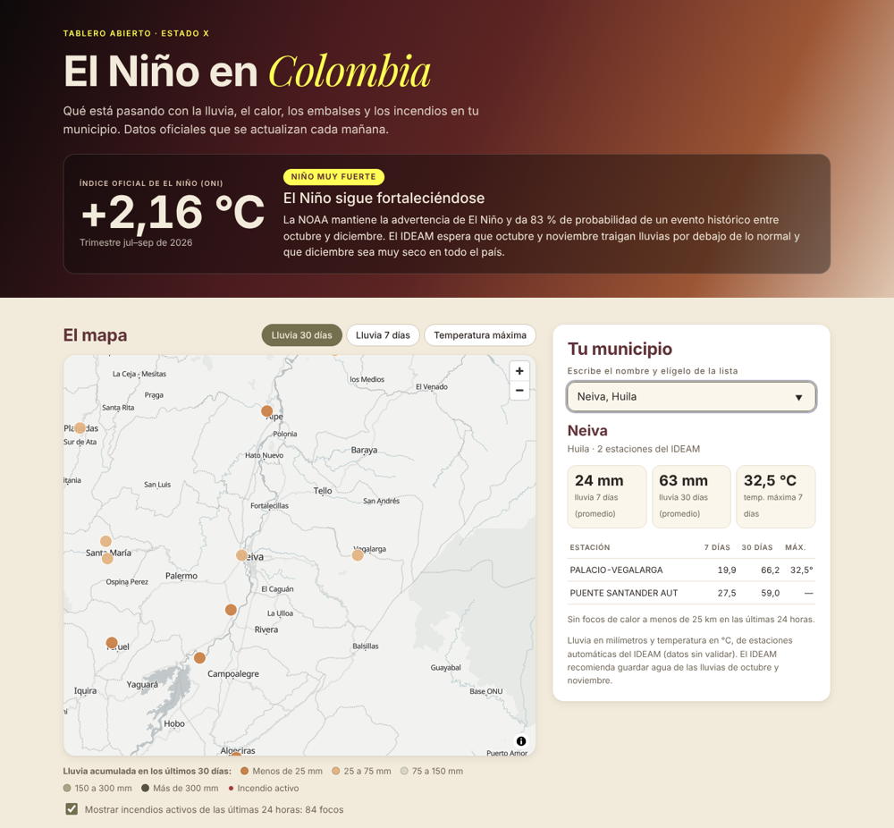

# El Niño en Colombia

**[Español](#español) · [English](#english)**

## Español

Tablero abierto para saber qué está pasando con **El Niño en tu municipio**: la lluvia, el calor, los embalses y los incendios activos, con datos oficiales que se actualizan solos cada mañana.

**Ábrelo aquí:** https://estado-x.github.io/nino-colombia/

### Qué muestra

| Capa | Qué ves | Fuente |
|---|---|---|
| Termómetro de El Niño | El índice oficial (ONI) por trimestres desde 2023 y qué tan fuerte es el evento | NOAA Climate Prediction Center |
| Lluvia | Milímetros acumulados en 7 y 30 días en cada estación automática | IDEAM, en datos.gov.co |
| Temperatura | Temperatura máxima de los últimos 7 días por estación | IDEAM, en datos.gov.co |
| Embalses | Volumen útil del sistema eléctrico, agua que llega frente a lo normal y los embalses más bajos | XM |
| Incendios | Focos de calor detectados por satélite en las últimas 24 horas | NASA FIRMS (VIIRS) |
| Tu municipio | Lo anterior para las estaciones de tu municipio y los focos de calor a menos de 25 km | Todas las anteriores |

Además trae lo último que dicen la NOAA y el IDEAM, con enlace a cada fuente.

### Cómo funciona

- Es una página estática (HTML, CSS y JavaScript) publicada con GitHub Pages. No tiene servidor ni base de datos, y no necesita claves.
- Todos los días a las 6:00 a. m. (hora de Colombia), GitHub Actions corre `scripts/actualizar_datos.py`. El script baja los datos de las cuatro fuentes, los resume y los guarda en `data/`.
- Si una fuente falla, las demás se actualizan igual y esa capa conserva los datos del día anterior.
- El texto de las fuentes oficiales vive en `data/estado-oficial.json` y se actualiza a mano con cada boletín.

### Úsalo o adáptalo

1. Haz un fork de este repositorio.
2. Activa GitHub Pages (Settings → Pages → rama `main`, carpeta raíz) y GitHub Actions.
3. Corre una vez el flujo **Actualizar datos** desde la pestaña Actions.

Para probarlo en tu computador: `python scripts/actualizar_datos.py` y luego `python -m http.server`. Solo usa la biblioteca estándar de Python 3.9 o superior.

¿Quieres otra región? Cambia el contorno de `data/colombia.geojson` y las consultas del script.

### Límites

- No es un pronóstico y **no reemplaza las alertas del IDEAM ni de la UNGRD**.
- Los datos de las estaciones automáticas no están validados. El script descarta valores imposibles: más de 2.000 mm en 30 días, más de 800 mm en 7 días, o temperaturas máximas por fuera de 5 a 45 °C.
- La lluvia se muestra en milímetros acumulados, sin compararla con lo normal: no hay un dato abierto de normales por estación que se pueda consultar así.
- Un foco de calor no siempre es un incendio forestal. También aparecen quemas agrícolas y fuentes industriales.
- Solo aparecen los municipios que tienen una estación automática del IDEAM con datos.

### Crédito

Inspirado en **[osiris](https://github.com/simplifaisoul/osiris)** de simplifaisoul (licencia MIT): la idea de juntar fuentes públicas en vivo sobre un mismo mapa. Este repositorio es una versión nueva, escrita desde cero y enfocada en El Niño y en Colombia. No reutiliza código de osiris.

Mapa base: [OpenFreeMap](https://openfreemap.org), © colaboradores de [OpenStreetMap](https://www.openstreetmap.org/copyright). Contorno de Colombia: [Natural Earth](https://www.naturalearthdata.com) (dominio público). Mapa con [MapLibre GL JS](https://maplibre.org).

Los datos son de sus autores: NOAA, IDEAM, XM y NASA. Revisa los términos de uso de cada fuente antes de reutilizarlos.

Hecho por **[Estado X](https://estadox.com)** · Código con licencia MIT.

---

## English

An open dashboard that shows what **El Niño** is doing in each Colombian municipality: rainfall, heat, hydropower reservoirs and active fires. It uses official data that updates itself every morning.

**Open it here:** https://estado-x.github.io/nino-colombia/

### What it shows

| Layer | What you see | Source |
|---|---|---|
| El Niño thermometer | The official Oceanic Niño Index (ONI) by season since 2023, and how strong the event is | NOAA Climate Prediction Center |
| Rainfall | 7- and 30-day accumulated rainfall at each automatic weather station | IDEAM, via datos.gov.co |
| Temperature | Maximum temperature over the last 7 days, by station | IDEAM, via datos.gov.co |
| Reservoirs | Usable storage of the power system, inflows compared with normal, and the lowest reservoirs | XM |
| Fires | Satellite fire hotspots from the last 24 hours | NASA FIRMS (VIIRS) |
| Your municipality | All of the above for the stations in your municipality, plus hotspots within 25 km | All of the above |

It also includes the latest statements from NOAA and IDEAM, each linked to its source.

### How it works

- It is a static page (HTML, CSS and JavaScript) published with GitHub Pages. There is no server, no database and no API keys.
- Every day at 6:00 a.m. Colombia time, GitHub Actions runs `scripts/actualizar_datos.py`. The script downloads the four sources, summarizes them and saves the results to `data/`.
- If one source fails, the others still update and that layer keeps the previous day's data.
- The official statements live in `data/estado-oficial.json` and are updated by hand with each bulletin.

### Use it or adapt it

1. Fork this repository.
2. Turn on GitHub Pages (Settings → Pages → `main` branch, root folder) and GitHub Actions.
3. Run the **Actualizar datos** workflow once from the Actions tab.

To try it on your computer, run `python scripts/actualizar_datos.py` and then `python -m http.server`. It only needs the Python 3.9+ standard library.

To use another region, swap the outline in `data/colombia.geojson` and the queries in the script.

### Limits

- It is not a forecast and **does not replace IDEAM or UNGRD alerts**.
- Automatic station data is not quality-controlled. The script drops impossible values: more than 2,000 mm in 30 days, more than 800 mm in 7 days, or maximum temperatures outside 5–45 °C.
- Rainfall is shown as accumulated millimetres, not compared with normal, because there is no open per-station climatology that can be queried this way.
- A fire hotspot is not always a wildfire. Agricultural burning and industrial heat sources also show up.
- Only municipalities with an IDEAM automatic station that reports data are listed.

### Credit

Inspired by **[osiris](https://github.com/simplifaisoul/osiris)** by simplifaisoul (MIT license), and its idea of bringing live public sources together on one map. This repository is a new version written from scratch for El Niño and Colombia. It does not reuse osiris code.

Base map: [OpenFreeMap](https://openfreemap.org), © [OpenStreetMap](https://www.openstreetmap.org/copyright) contributors. Colombia outline: [Natural Earth](https://www.naturalearthdata.com) (public domain). Map rendering: [MapLibre GL JS](https://maplibre.org).

The data belongs to its publishers: NOAA, IDEAM, XM and NASA. Check each source's terms of use before reusing it.

Made by **[Estado X](https://estadox.com)** · Code under the MIT license.
