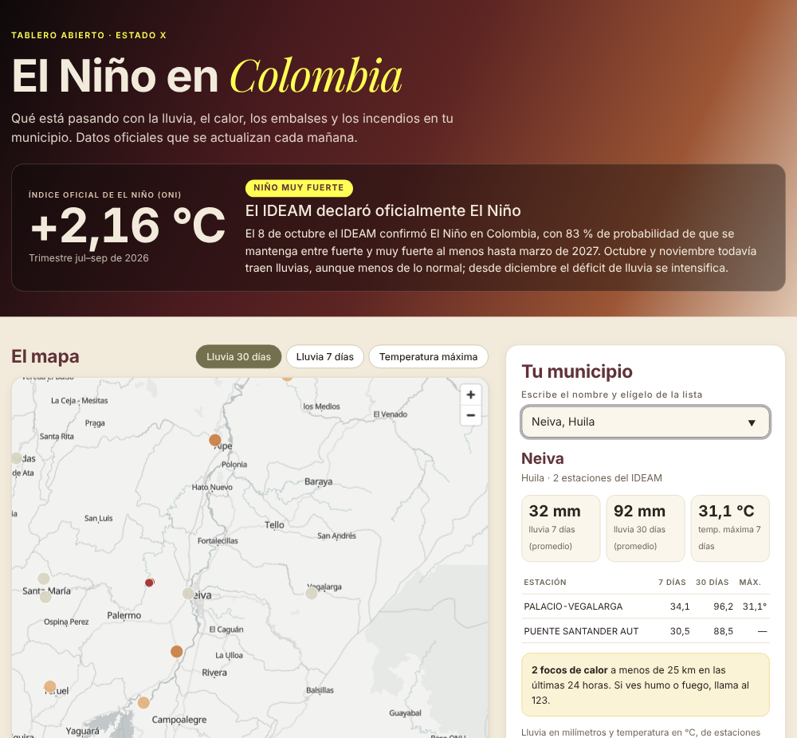

# El Niño en Colombia

**[Español](#español) · [English](#english)**

## Español

Tablero abierto para saber qué está pasando con **El Niño en tu municipio**: la lluvia, el calor, los embalses y los incendios activos, con datos oficiales que se actualizan solos una vez al día.

**Ábrelo aquí:** https://estado-x.github.io/nino-colombia/

### Qué muestra

| Capa | Qué ves | Fuente |
|---|---|---|
| Termómetro de El Niño | El índice oficial (ONI) por trimestres desde 2023 y qué tan fuerte es el evento | NOAA Climate Prediction Center |
| Lluvia | Milímetros acumulados en 7 y 30 días en cada estación automática | IDEAM, en datos.gov.co |
| Temperatura | Temperatura máxima de los últimos 7 días por estación | IDEAM, en datos.gov.co |
| Embalses | Volumen útil del sistema eléctrico, agua que llega frente a lo normal y los embalses más bajos | XM |
| Incendios | Focos de calor detectados por satélite en las últimas 24 horas | NASA FIRMS (VIIRS NOAA-20; si falla, NOAA-21) |
| Tu municipio | Los 1.122 municipios del DANE: las estaciones de tu municipio (o las tres más cercanas si no tiene) y los focos de calor a menos de 25 km. Lo buscas por nombre o con tu ubicación, y tiene enlace propio para compartir | Todas las anteriores y DANE (DIVIPOLA) |

Además trae lo último que dicen la NOAA y el IDEAM, con enlace a cada fuente, y:

- **Ficha para el consejo municipal de gestión del riesgo:** una página para imprimir o guardar en PDF con los datos de tu municipio y del país, los límites y los enlaces a las alertas del IDEAM.
- **Este Niño frente al de 2015–2016:** las dos curvas del índice en la misma gráfica, trimestre a trimestre.
- **Enlace por municipio:** por ejemplo `https://estado-x.github.io/nino-colombia/?municipio=41001` (el número es el código DANE).

### Cómo funciona

- Es una página estática (HTML, CSS y JavaScript) publicada con GitHub Pages. No tiene servidor ni base de datos, y no necesita claves.
- Una vez al día, GitHub Actions corre `scripts/actualizar_datos.py` (está programado para las 6:00 a. m. de Colombia, pero GitHub suele arrancarlo varias horas después). El script baja los datos de las cuatro fuentes, los resume y los guarda en `data/`.
- Si una fuente falla o responde vacía, las demás se actualizan igual y esa capa conserva los datos del día anterior. El problema queda anotado en `data/corrida.json`. Si el archivo de incendios de la NASA llega vacío, la página dice «Hoy no hay datos de incendios» en vez de mostrar cero focos.
- El texto de las fuentes oficiales vive en `data/estado-oficial.json` y se actualiza a mano con cada boletín.
- La lista de municipios (`data/municipios.json`) sale del DANE y se arma a mano con `python scripts/armar_municipios.py` cuando cambie la división política.
- «Usar mi ubicación» compara tu posición con el punto de referencia de cada municipio dentro de tu navegador: no se guarda ni se envía a ningún lado.

### Úsalo o adáptalo

1. Haz un fork de este repositorio.
2. Activa GitHub Pages (Settings → Pages → rama `main`, carpeta raíz) y GitHub Actions.
3. Corre una vez el flujo **Actualizar datos** desde la pestaña Actions.

Para probarlo en tu computador: `python scripts/actualizar_datos.py` y luego `python -m http.server`. Solo usa la biblioteca estándar de Python 3.9 o superior.

¿Quieres otra región? Cambia el contorno de `data/colombia.geojson` y las consultas del script.

### Cómo colaborar

Es abierto y gratuito: úsalo, cópialo o ayúdanos a mejorarlo. No hace falta saber programar.

- ¿Algo no funciona o tienes una idea? [Abre un issue](https://github.com/Estado-X/nino-colombia/issues/new/choose) con una de las plantillas.
- ¿Quieres programar? Busca los issues marcados como **buena primera tarea**.
- La guía completa está en [CONTRIBUTING.md](CONTRIBUTING.md).

### Límites

- No es un pronóstico y **no reemplaza las alertas del IDEAM ni de la UNGRD**.
- Los datos de las estaciones automáticas no están validados. El script descarta valores imposibles: más de 2.000 mm en 30 días, más de 800 mm en 7 días, o temperaturas máximas por fuera de 5 a 45 °C.
- La lluvia se muestra en milímetros acumulados, sin compararla con lo normal: no hay un dato abierto de normales por estación que se pueda consultar así.
- Un foco de calor no siempre es un incendio forestal. También aparecen quemas agrícolas y fuentes industriales.
- Si tu municipio no tiene una estación automática del IDEAM con datos, se muestran las tres más cercanas, que pueden estar en otro municipio y a otra altura.
- «Usar mi ubicación» da el municipio más cercano a tu posición según el punto de referencia del DANE, que no es el contorno del municipio: cerca de un límite puede equivocarse.

### Crédito

Inspirado en **[osiris](https://github.com/simplifaisoul/osiris)** de simplifaisoul (licencia MIT): la idea de juntar fuentes públicas en vivo sobre un mismo mapa. Este repositorio es una versión nueva, escrita desde cero y enfocada en El Niño y en Colombia. No reutiliza código de osiris.

Mapa base: [OpenFreeMap](https://openfreemap.org), © colaboradores de [OpenStreetMap](https://www.openstreetmap.org/copyright). Contorno de Colombia: [Natural Earth](https://www.naturalearthdata.com) (dominio público). Mapa con [MapLibre GL JS](https://maplibre.org).

Lista de municipios: [DANE, DIVIPOLA - Códigos municipios](https://www.datos.gov.co/Mapas-Nacionales/DIVIPOLA-C-digos-municipios/gdxc-w37w), licencia [CC BY-SA 4.0](https://creativecommons.org/licenses/by-sa/4.0/deed.es); `data/municipios.json` es una versión resumida y se comparte con la misma licencia. Letra de los títulos: [Inter](https://github.com/rsms/inter), licencia SIL OFL 1.1 (`assets/fuentes/OFL-Inter.txt`).

Los datos son de sus autores: NOAA, IDEAM, XM, NASA y DANE. Revisa los términos de uso de cada fuente antes de reutilizarlos.

Hecho por **[Estado X](https://estadox.com)** · Código con licencia MIT.

---

## English

An open dashboard that shows what **El Niño** is doing in each Colombian municipality: rainfall, heat, hydropower reservoirs and active fires. It uses official data that updates itself once a day.

**Open it here:** https://estado-x.github.io/nino-colombia/

### What it shows

| Layer | What you see | Source |
|---|---|---|
| El Niño thermometer | The official Oceanic Niño Index (ONI) by season since 2023, and how strong the event is | NOAA Climate Prediction Center |
| Rainfall | 7- and 30-day accumulated rainfall at each automatic weather station | IDEAM, via datos.gov.co |
| Temperature | Maximum temperature over the last 7 days, by station | IDEAM, via datos.gov.co |
| Reservoirs | Usable storage of the power system, inflows compared with normal, and the lowest reservoirs | XM |
| Fires | Satellite fire hotspots from the last 24 hours | NASA FIRMS (VIIRS NOAA-20, with NOAA-21 as backup) |
| Your municipality | All 1,122 DANE municipalities: the stations in your municipality (or the three closest if it has none) and hotspots within 25 km. Search by name or use your location; each one has its own link to share | All of the above and DANE (DIVIPOLA) |

It also includes the latest statements from NOAA and IDEAM, each linked to its source, plus:

- **A one-page sheet for the municipal disaster risk council**, ready to print or save as PDF.
- **This El Niño compared with 2015–2016**, season by season, on the same chart.
- **A link per municipality**, for example `https://estado-x.github.io/nino-colombia/?municipio=41001` (the number is the DANE code).

### How it works

- It is a static page (HTML, CSS and JavaScript) published with GitHub Pages. There is no server, no database and no API keys.
- Once a day, GitHub Actions runs `scripts/actualizar_datos.py` (scheduled for 6:00 a.m. Colombia time, though GitHub often starts it several hours later). The script downloads the four sources, summarizes them and saves the results to `data/`.
- If one source fails or comes back empty, the others still update and that layer keeps the previous day's data. The problem is logged in `data/corrida.json`. If NASA's fire file comes back empty, the page says there is no fire data today instead of showing zero hotspots.
- The official statements live in `data/estado-oficial.json` and are updated by hand with each bulletin.
- The municipality list (`data/municipios.json`) comes from DANE and is rebuilt by hand with `python scripts/armar_municipios.py`.
- "Use my location" compares your position with each municipality's reference point inside your browser; it is never stored or sent anywhere.

### Use it or adapt it

1. Fork this repository.
2. Turn on GitHub Pages (Settings → Pages → `main` branch, root folder) and GitHub Actions.
3. Run the **Actualizar datos** workflow once from the Actions tab.

To try it on your computer, run `python scripts/actualizar_datos.py` and then `python -m http.server`. It only needs the Python 3.9+ standard library.

To use another region, swap the outline in `data/colombia.geojson` and the queries in the script.

### How to contribute

It is open and free: use it, copy it or help us improve it. You do not need to code.

- Something broken or an idea? [Open an issue](https://github.com/Estado-X/nino-colombia/issues/new/choose) with one of the templates.
- Want to code? Look for issues labeled **good first task** (*buena primera tarea*).
- The full guide (in Spanish) is in [CONTRIBUTING.md](CONTRIBUTING.md).

### Limits

- It is not a forecast and **does not replace IDEAM or UNGRD alerts**.
- Automatic station data is not quality-controlled. The script drops impossible values: more than 2,000 mm in 30 days, more than 800 mm in 7 days, or maximum temperatures outside 5–45 °C.
- Rainfall is shown as accumulated millimetres, not compared with normal, because there is no open per-station climatology that can be queried this way.
- A fire hotspot is not always a wildfire. Agricultural burning and industrial heat sources also show up.
- If your municipality has no IDEAM automatic station with data, the three closest stations are shown; they may be in another municipality and at a different altitude.
- "Use my location" picks the municipality whose DANE reference point is closest, not its boundary, so it can be wrong near a border.

### Credit

Inspired by **[osiris](https://github.com/simplifaisoul/osiris)** by simplifaisoul (MIT license), and its idea of bringing live public sources together on one map. This repository is a new version written from scratch for El Niño and Colombia. It does not reuse osiris code.

Base map: [OpenFreeMap](https://openfreemap.org), © [OpenStreetMap](https://www.openstreetmap.org/copyright) contributors. Colombia outline: [Natural Earth](https://www.naturalearthdata.com) (public domain). Map rendering: [MapLibre GL JS](https://maplibre.org).

Municipality list: DANE DIVIPOLA (datos.gov.co, gdxc-w37w), CC BY-SA 4.0; `data/municipios.json` is a summarized version shared under the same license. Title font: Inter, SIL OFL 1.1.

The data belongs to its publishers: NOAA, IDEAM, XM, NASA and DANE. Check each source's terms of use before reusing it.

Made by **[Estado X](https://estadox.com)** · Code under the MIT license.
